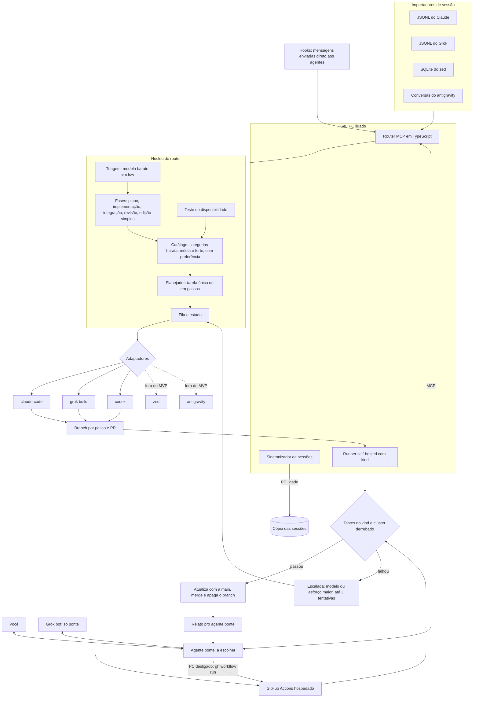

# LLM-Router: arquitetura

Router de agentes exposto como servidor MCP (TypeScript), com um agente ponte que conversa com o usuário, escolhe agente, modelo e esforço por fase, verifica por CI e funciona com o PC ligado (local) ou desligado (GitHub Actions).

## Diagrama



## Estrutura do repositório

```
agent-router/
  src/
    server.ts            # ferramentas MCP: route, plan, run_plan, status, import_sessions, check_models
    triage/              # classifica a fase com um modelo barato em low
    policy/              # fases, categorias, preferências e a base do effortless
    catalog/             # modelos por agente e teste de disponibilidade
    planner/             # tarefa única ou dividida em passos
    queue/               # estado das tarefas (SQLite)
    adapters/            # claude-code, grok-build, zed, antigravity, codex, grok-bot
    importers/           # leitores de sessão de cada agente
    verify/              # dispara o CI, acompanha, faz merge ou escala
    dispatch/            # escolhe entre modo local e modo nuvem
  sync/                  # sincronizador de sessões do PC
  hooks/                 # interceptação de mensagens (ex.: UserPromptSubmit do claude-code)
  ci/
    router-verify.yml    # testes no kind e merge (runner self-hosted)
    router-cloud.yml     # mesmo fluxo via workflow_dispatch, pra quando o PC estiver desligado
    needs-cluster.sh     # decide se o kind sobe (auto|kind|off); chamado por pr-ci.sh
    kind-up.sh / kind-down.sh
  config/router.yaml     # catálogo, fases, preferências, escalada, merge automático
```

## Configuração de exemplo (`config/router.yaml`)

O bloco abaixo é o desenho original, não o catálogo em uso. A configuração atual está em `config/router.yaml`; preços e critérios OpenAI estão em [docs/model-policy.md](docs/model-policy.md). A disponibilidade depende da conta e do ping.

```yaml
triage: { tier: cheap, effort: low, role: classify_only }

models:
  gemini-flash:   { via: [antigravity, zed], tier: cheap }
  haiku:          { via: [claude-code, zed], tier: cheap }
  grok-fast:      { via: grok-build,         tier: cheap }
  codex-mini:     { via: codex,              tier: cheap }
  sonnet:         { via: [claude-code, zed], tier: mid }
  gpt-codex:      { via: codex,              tier: mid }
  gemini-pro:     { via: [antigravity, zed], tier: strong }
  opus:           { via: [claude-code, zed], tier: strong }
  grok-reasoning: { via: grok-build,         tier: strong }

tiers:
  cheap:  [gemini-flash, haiku, grok-fast, codex-mini]   # Gemini antes do Haiku
  mid:    [sonnet, gpt-codex]
  strong: [opus, gemini-pro, grok-reasoning]   # cada modelo em uma só categoria (gemini-pro só em strong)

phases:
  planning:     { tier: strong, effort: high }
  implementing: { tier: mid,    effort: [medium, high] }
  integration:  { tier: strong, effort: [medium, high] }
  full_review:  { tier: strong, effort: high }
  simple_edit:  { tier: cheap,  effort: low }

escalation:
  triggers: [ci_failed, agent_blocked, user_override]
  max_attempts: 3

verify:
  mode: ci            # juiz por LLM só como opção, desligado
  auto_merge: true    # exige todos os checks verdes e rebase na main
  delete_branch: true
  push: always        # always|never: sobe todo branch de passo para origin (backup); padrão always

dispatch:
  local: self-hosted   # PC ligado
  cloud: github-actions # PC desligado (workflow_dispatch, chaves nos Secrets)
```

## Escopo do MVP

- **Dentro:** adaptadores `claude-code`, `grok-build` e `codex`, triagem, planejador, CI no kind, merge automático, modo nuvem.
- **Fora do MVP:** adaptadores `zed` e `antigravity`, e todos os importadores de sessão (JSONL do Claude/Grok, SQLite do zed, conversas do antigravity). Aparecem no diagrama e na estrutura como destino, não como entrega.
- **Grok bot:** só ponte (canal de conversa com o usuário), nunca executa passos; não é um adaptador de execução.
- **Categorias:** cada modelo vive em uma só categoria (ex.: `gemini-pro` só em strong); o fallback nunca desce de categoria.

## Regras principais

1. **Triagem:** toda requisição chega primeiro a um modelo barato em low, que só classifica a fase, desenha o fluxo, despacha e para.
2. **Fase define a categoria:** planejamento, integração e revisão completa vão pra modelos fortes; implementação de features já desenhadas vai pra médios (ex.: Sonnet em medium ou high); edição simples vai pra baratos.
3. **Preferência e fallback:** dentro da categoria vale a ordem configurada (ex.: Gemini Flash antes do Haiku); modelo indisponível ou sem cota passa pro próximo.
4. **Teste de disponibilidade:** na inicialização e periodicamente, cada adaptador lista modelos e faz um ping mínimo pra confirmar acesso.
5. **Verificação por CI:** cada passo em branch próprio; testes em cluster kind efêmero; se passar, rebase, merge na main e branch apagado; se falhar, escalada até 3 tentativas.
6. **Coexistência com o effortless:** o router define modelo e esforço só no despacho; dentro da sessão do claude-code, o effortless continua ajustando. Os parâmetros dele servem de base.
7. **Modo nuvem:** com o PC desligado, o disparo vai pro GitHub Actions hospedado, com as mesmas regras. As sessões locais entram quando o PC liga e sincroniza.

## Locais verificados neste PC

| Agente | Binário | Sessões |
|---|---|---|
| claude-code 2.1.314 | `~/.local/bin/claude` | `~/.claude/projects/<cwd>/<uuid>.jsonl` |
| grok build | `~/.local/bin/grok` (`-m`, `--reasoning-effort`, `-p`, `--output-format json`) | `~/.grok/sessions/<cwd>/<id>/chat_history.jsonl` |
| zed | `~/.local/bin/zed` | `~/.local/share/zed/threads/threads.db` (SQLite) |
| antigravity | `~/.gemini/bin/agy` | `~/.gemini/antigravity/conversations` (protobuf) |
| codex | `~/.local/bin/codex` (CLI 0.166.0; `exec --json --ephemeral`) | sessões efêmeras no router |

## Extensão Codex (2026-10-30) e estado real

- `src/adapters/codex.ts` executa Codex CLI em sandbox e normaliza JSONL. `registry.ts` reúne os três adaptadores para MCP, CLI e benchmark.
- Luna (cheap), Sol (mid) e Astra (strong) integram o catálogo; Terra (mid especializado) fica desativado. `phases.<fase>.prefer` define Opus para planejar, Sol para implementar e Astra para integrar/revisar, com alternativas da mesma categoria. Preços Claude/OpenAI têm fonte/data; `route` expõe diretrizes do modelo selecionado.
- Tokens de cache Codex são separados do total de entrada. Custos sem valor fornecido pelo CLI são estimados; o relatório não confirma fatura nem saldo de assinatura.
- As seções e o diagrama anteriores descrevem também objetivos futuros: cloud ainda é esqueleto; dispatch/recuperação não estão ligados ao fluxo principal; hook apenas registra mensagens. O banco global ainda exige separação por projeto via `ROUTER_DB`.
- O executor continua exigindo alterações Git, portanto perguntas e revisões sem alteração não têm fluxo próprio. `verify.auto_merge: false` agora para após o CI verde, com o PR aberto. Não foram corrigidos nesta extensão.
- Diretrizes de contribuição: [AGENTS.md](AGENTS.md). Operação: [README.md](README.md). Validação: [docs/e2e-smoke.md](docs/e2e-smoke.md). Documentos em `.planning/` preservam o escopo histórico do MVP.

## Correção de execução e conexão

`Exec` usa descritores de arquivos temporários privados e retorna a saída após o processo terminar. Isso evita stdout/stderr descartados por Node ao identificar sockets em um sandbox restrito. Recursos são limpos em sucesso, falha e timeout.

O launcher `bin/router-mcp.py` usa pipes convencionais, encaminha sinais e força encerramento do grupo após cinco segundos quando necessário. O MCP foi registrado no Claude Code com caminhos absolutos e `ROUTER_CHECK_MODELS=manual`, evitando pings pagos na abertura. Handshake e chamadas MCP locais foram testados; o cliente Claude e a inferência real continuam bloqueados neste ambiente por restrições de sockets/DNS. Registro não equivale a conexão comprovada.
