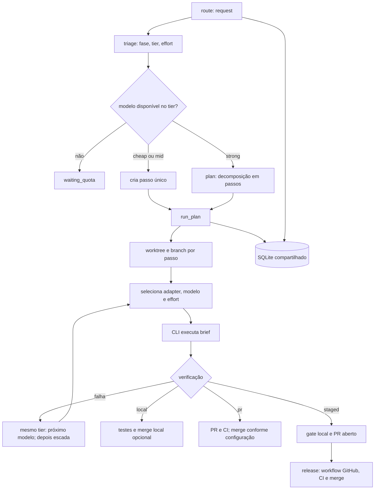

# Fluxo completo do LLM-Router

Este documento descreve o comportamento implementado em `src/` e `config/router.yaml` neste branch. O servidor MCP é local; chamadas de modelos são feitas pelos CLIs instalados na máquina.

## Visão geral



## Ferramentas MCP

Todas as respostas normais são JSON serializado em texto. Erros de negócio são retornados com `isError: true` e mensagem.

| Ferramenta | Entrada | Saída / efeito |
|---|---|---|
| `route` | `{request, override_tier?}` | Classifica e grava tarefa. Retorna `task_id`, `phase`, `tier`, `model`, `adapter`, `effort`, opcionalmente `guidance` e `pricing`, e `next` (`wait`, `plan` ou `run`). `override_tier` escolhe a primeira fase configurada nesse tier. |
| `plan` | `{task_id}` | Para tarefa strong sem passos, chama planejador e grava passos. Retorna sequência, tier, brief, dependências por número e arquivos. |
| `run_plan` | `{task_id}` | Inicia execução sem esperar. Retorna números de passos `started` (sem dependências) e `waiting` (com dependências); consulte `status`. |
| `status` | `{task_id?}` | Sem ID retorna custos agregados por tier e baseline strong. Com ID retorna tarefa, passos, tentativas e custos. `billing_verified` é sempre `false`. |
| `check_models` | `{}` | Faz ping de todos os modelos configurados e retorna disponibilidade, quota e horário. Pings consomem tokens. |
| `relay` | `{body, task_id?}` | Envia ao transporte do bot Grok; se falhar, registra canal `claude` para consulta. Retorna canal e `delivered`. |
| `release` | `{sync_only?}` | Normalmente dispara `router-release.yml` para PRs staged pendentes, retorna PRs e `next: status`; `sync_only: true` apenas sincroniza estado local com GitHub. |

## Classificação, plano e seleção

`route` chama triage, que pede JSON `{phase,tier}` ao modelo de `triage.model` (`haiku-5-5`, low, read-only), usando o prompt em português. Valida fase e consistência do tier com `phases`. Há até duas respostas inválidas; quota esgotada marca o modelo e tenta novamente. Sem modelo cheap disponível, falha. Com `override_tier`, não chama modelo e escolhe a primeira fase daquele tier.

Fases atuais: `simple_edit` → cheap/low; `implementing` → mid/medium; `planning`, `integration`, `full_review` → strong/high. A seleção considera primeiro `phases.<fase>.prefer`, depois `tiers.<tier>`; ignora `enabled: false` e indisponibilidade registrada. Sem estado registrado, o modelo conta como disponível. Passos com `role` ou `phase` (gerados pela decomposição) usam `selectForRole` (`src/planner/selection.ts`): só `claude-code`/`codex`, mais barato por `price.input + price.output` dentro da categoria capaz, empate decidido por `prefer`. Passos sem papel/fase seguem só a ordem configurada. A config atual tem Haiku/Luna em cheap, Sonnet/Sol/Terra em mid e Opus/Astra em strong; Terra está desativado. Grok não consta nos modelos/tier ativos.

Cheap e mid geram um único passo com o pedido original. Strong requer `plan`: Opus/Astra em read-only devolve JSON de passos, cada um com tier, brief, dependências e arquivos. O planejador rejeita dependência futura, acrescenta dependência quando dois passos tocam o mesmo arquivo e grava o grafo. O `run_plan` agenda passos com dependências satisfeitas em paralelo, no máximo `verify.max_parallel` (padrão 2) ao mesmo tempo por plano; `pr_open` conta como satisfeito para dependentes staged.

Dentro de `run_plan`, cada passo commita antes do gate (também no modo `pr`) e grava um handoff em `steps.handoff`: brief, diff `base...HEAD`, achados (texto final do agente e da revisão), modelo autor, sinais de risco e veredito da revisão. O prompt do dependente recebe `Contexto das dependências (JSON)` com os handoffs de todos os `depends_on`, inclusive em retomada. Passos com risco (fase planning/integration/full_review, arquivos sensíveis como auth/db/migration/api/policy/runner, palavras de risco no brief, SQL destrutivo/`eval`/`exec` no diff ou diff com mais de 100 linhas) passam por revisão cruzada read-only antes do gate e da publicação: autor Codex → `sonnet-5-5`, autor Claude → `gpt-6.1-sol`, em `medium`. Revisor indisponível deixa o passo `waiting_quota` (nunca cai para o mesmo fornecedor). Reprovação vira falha de gate: reparo pontual, nova revisão e só então a escada. Tentativas `review` não contam no `max_attempts`.

## Execução, adapters e escalada

Cada passo recebe branch `router/step-<id-prefixo>` e worktree em `.worktrees/`. Passos dependentes de PR staged partem do branch remoto da dependência. O base vem de `ROUTER_BASE` ou do branch em checkout quando o servidor iniciou. Com `verify.push: always` (padrão do runner), branches são publicados como backup. O comportamento de PR depende de `verify.mode`: `pr` publica branch e abre PR; `staged` só publica depois do gate local. No modo local pode haver push do branch/base conforme configuração.

O brief é passado ao CLI como argumento, sem shell. Cada tentativa abre sessão nova e recebe o brief, mais o motivo da falha anterior quando houver. Comandos abaixo mostram exatamente a composição do adapter para uma execução de escrita com modelo `gpt-6.1-sol`, esforço `medium` e prompt `Implemente o brief.`; o processo recebe argv, não uma linha interpretada pelo shell:

```text
claude -p "Implemente o brief." --model claude-sonnet-5-5 --effort medium --output-format json --no-session-persistence --permission-mode acceptEdits --setting-sources project --strict-mcp-config --disable-slash-commands --system-prompt "Você é um agente de código. Faça exatamente o que o brief pede, mude só o necessário e responda curto." --tools Read,Write,Edit,Glob,Grep,Bash
codex exec --json --ephemeral --ignore-user-config --model gpt-6.1-sol --sandbox workspace-write --config 'approval_policy="never"' --config 'model_reasoning_effort="medium"' -- "Implemente o brief."
```

Claude usa `claude -p` com saída JSON; extrai `result`, usage e `total_cost_usd`. Codex lê JSONL, exige evento `turn.completed`, usa a última mensagem `agent_message` e tokens do evento; custo vem estimado pelo catálogo (`cost_usd: null`). Codex usa sandbox `workspace-write`, `approval_policy="never"` e ignora config global; isso não desativa o sandbox. Triage/planejamento/ping usam read-only; Codex acrescenta `--skip-git-repo-check` em read-only. Grok adapter existe no código, mas não participa da seleção pela config ativa.

Em falha de quota, o modelo é marcado exhausted e o router tenta outro no mesmo tier. Em outra falha, tenta outros modelos do mesmo degrau antes de avançar. Escada configurada: cheap low → mid medium → mid high; mid medium → mid high → mid xhigh; strong high → strong xhigh (a escada strong tem dois degraus, apesar de `max_attempts: 3`). Seleção continua no tier do degrau; não há escalada mid→strong. Sem modelo elegível, passo fica `waiting_quota`.

"Agent made no changes" não escala: o router roda o gate local (`verify.local.cmds`; no `local` o `verifyLocal`, que também integra commits de tentativas anteriores). Se passar, o passo fica `done` e a tentativa registra `ci_result: "already satisfied"`. Se falhar, há uma única nova tentativa com o mesmo modelo e esforço, cujo prompt traz a saída do gate como o que falta. Se ela falhar de qualquer forma, o passo fica `failed`. Sem `verify.local.cmds` a base não é dada como atendida. Se faltar cota na retentativa, o passo fica `waiting_quota` em vez de trocar de modelo.

## Verificação e estado

- `local`: comandos de `verify.local.cmds` rodam em ordem no worktree; primeiro erro encerra. Com `auto_merge`, rebaseia no base e faz fast-forward local serializado. Não reroda os testes após rebase.
- `pr`: publica/abre PR, espera checks do GitHub e, com `auto_merge: true`, mergeia com rebase. `auto_merge: false` deixa PR aberto após CI verde.
- `staged`: faz fetch/rebase em `origin/<base>` e gateia com comandos locais. Se verde, abre PR e marca `awaiting_release`; CI e merge só após `release`. O workflow compara PRs `router/*`, executa CI, mergeia os verdes e sincroniza estado. `docs/staged-verify-design.md` detalha o desenho.

O CI decide cluster via `CI_CLUSTER` (ambiente GitHub/repositório), `verify.cluster` ou `auto`. Em `auto`, `ci/needs-cluster.sh` detecta manifests e sinais de testes Kubernetes; só então sobe kind. A heurística e limites estão descritos no README.

Tarefas, passos, tentativas, modelos e mensagens ficam em SQLite. O banco padrão é `~/.local/share/llm-router/router.db`; servidor e hook usam o mesmo arquivo, WAL e `busy_timeout`. `ROUTER_DB` substitui o caminho. É compartilhado entre projetos da máquina e não particiona registros por repositório.

## Planejado, ainda não implementado

- **Decomposição multi-tarefa automática:** não existe roteador que transforme implicitamente toda solicitação em plano; apenas `plan` explícito para tarefa strong. O prompt do planner já divide em passos, mas isso não é decomposição multi-tarefa automática da conversa.
- **Contrato completo de cooperação:** `acceptance`, `output`, `risk` declarados pelo planner, subtarefas `review_of` e o estado `awaiting_review` de `docs/agent-cooperation.md` não existem. O risco é inferido pela heurística acima e a revisão roda dentro do próprio passo.
- **Adapters automáticos:** registry e adapters são construídos pelo servidor; não há descoberta automática de CLI/modelos. `check_models` faz ping dos modelos declarados.
- **Roteamento implícito:** não há interceptação geral de mensagens para executar `route`; ferramentas MCP precisam ser chamadas explicitamente. `relay` é canal separado.

Planos existentes relacionados: [plano de verificação staged](staged-verify-design.md), [plano de integração Exec](exec-integration-plan.md) e [plano de implementação Codex](codex-implementation-plan.md). Eles não alteram o comportamento atual descrito acima.
